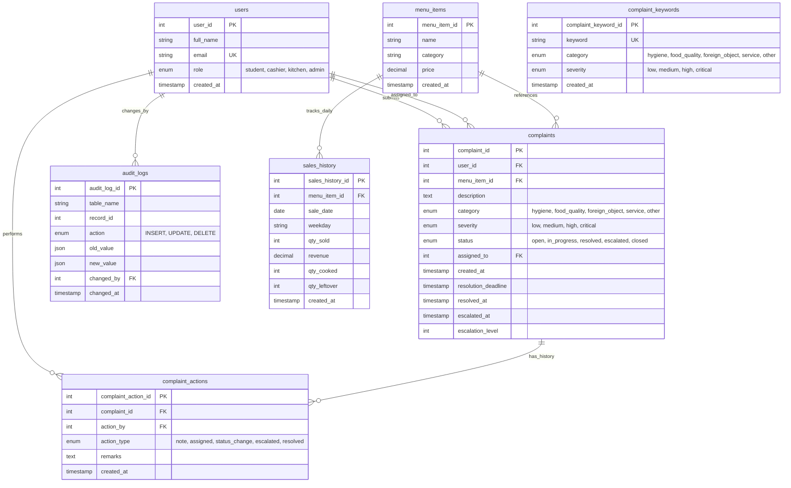

# PlateWise - Member 4 Module Documentation

> **Role & Scope**: Kitchen and Sales Analytics, Complaints and Escalation, Admin and Impact Dashboard, Database Objects (Triggers, Stored Procedures, Views, Indexes, RBAC), and Express API.

---

## 1. Quick Setup & Run Instructions

### Option A: Local Development with Mock Data (No Database Required)
The frontend includes full mock data mirroring the MySQL seed database.
```bash
# In project root:
npm install
npm run dev
```
Navigate to:
- **Developer Hub**: [http://localhost:5173/dev](http://localhost:5173/dev)
- **Kitchen & Demand Analytics**: [http://localhost:5173/kitchen](http://localhost:5173/kitchen)
- **Admin Governance & Sustainability**: [http://localhost:5173/admin](http://localhost:5173/admin)
- **Complaints & Escalation Desk**: [http://localhost:5173/admin/complaints](http://localhost:5173/admin/complaints)
- **Student Grievance Intake Form**: [http://localhost:5173/complaints/new](http://localhost:5173/complaints/new)
- **Landing Page (Unchanged)**: [http://localhost:5173/](http://localhost:5173/)

*(Use the **x-demo-role** dropdown in the dashboard header to test role-based access for `admin`, `kitchen`, and `student`)*

---

### Option B: Full-Stack with MySQL 8 (Docker)
1. **Start MySQL 8 container**:
   ```bash
   docker compose up -d
   ```
2. **Execute Database Setup & Seed (if not initialized automatically)**:
   ```bash
   cd backend
   npm install
   npm run db:setup
   npm test
   ```
3. **Start Express Backend**:
   ```bash
   npm start
   # Server runs on http://localhost:5000
   ```
4. **Start Frontend**:
   ```bash
   # From root:
   npm run dev
   ```

---

## 2. Mermaid Entity-Relationship (ER) Diagram



---

## 3. Database Normalization Notes (3NF Verification)

1. **1NF (First Normal Form)**:
   - Primary key is defined on every table (`table_id`).
   - All columns hold atomic, scalar values (no comma-separated tags or multi-value repeating columns).
   - Change capture logs store structured JSON payloads preserving state at point-of-change.
2. **2NF (Second Normal Form)**:
   - Relies on single-attribute surrogate keys (`sales_history_id`, `complaint_id`), guaranteeing that no partial functional dependencies exist.
   - All non-key attributes depend strictly on the whole primary key.
3. **3NF (Third Normal Form)**:
   - No transitive dependencies ($X \to Y \to Z$).
   - `complaints` links directly to `users(user_id)` and `menu_items(menu_item_id)` without duplicating dish names or user profile data.
   - `complaint_actions` separates lifecycle timeline notes from the ticket state to eliminate update anomalies.
   - `sales_history` is populated exclusively by the `refresh_sales_history` stored procedure from operational facts (`order_items`, `food_batches`), preventing OLAP locking overhead on real-time transaction processing.

---

## 4. Database Objects Catalog

### Triggers (`03_triggers.sql`)
- **`trg_complaints_before_insert`**: Dynamically calculates and assigns binding SLA `resolution_deadline` based on severity (`critical` = +2h, `high` = +4h, `medium` = +24h, `low` = +72h).
- **`trg_complaints_after_update`**: Automatically appends lifecycle records to `complaint_actions` on assignment/status transitions and logs JSON state snapshots into `audit_logs`.

### Stored Procedures & Events (`04_procedures.sql`)
- **`classify_complaint(p_description, p_category, p_severity)`**: Rule-based NLP classifier matching grievance keywords against `complaint_keywords` with priority ordering (`critical` > `high` > `medium` > `low`).
- **`submit_complaint(p_user_id, p_menu_item_id, p_description, ...)`**: Transactionally validates inputs, runs classifier, inserts complaint ticket, initial action note, and audit record atomically with rollback on error.
- **`escalate_overdue_complaints(p_escalated_count)`**: Idempotent escalation engine transitioning overdue tickets past SLA deadline to `escalated`, incrementing `escalation_level` without double-escalation within a 2-hour window.
- **`refresh_sales_history(p_date)`**: Aggregates daily fulfilled orders and kitchen production batches into analytical `sales_history` facts.
- **`get_demand_recommendation(p_target_date)`**: Forecasts batch production per dish using 4-week weekday moving averages, active pre-orders, and a >15% waste reduction factor, guarded against divide-by-zero.
- **`daily_sales_summary(p_date)`**: Aggregates daily portions sold, cooked, leftover, revenue, and waste percentage.
- **`evt_escalate_overdue` (MySQL Event)**: Scheduled background event executing `escalate_overdue_complaints` automatically every 5 minutes.

### Analytical Views (`05_views.sql`)
- **`v_daily_sales`**: Daily revenue and volume metrics with a 7-day rolling moving average of revenue (`ROWS BETWEEN 6 PRECEDING AND CURRENT ROW`).
- **`v_top_selling_items`**: Dish performance leaderboard ranked by total portions sold using `DENSE_RANK()`.
- **`v_most_wasted_items`**: Waste analytics ranking dishes by total leftover portions using `RANK()`.
- **`v_demand_weekday_avg`**: Multi-week weekday sales patterns partitioned by day of week using window functions.
- **`v_complaint_dashboard`**: Aggregated KPI counts for open, in-progress, escalated, resolved, and overdue grievances.
- **`v_overdue_complaints`**: Filtered list of tickets currently breaching SLA deadlines with calculated hours overdue.
- **`v_impact_summary`**: Campus zero-waste metrics: total portions saved, donated, and wasted with overall campus waste percentage.
- **`v_monthly_trend`**: Month-over-month sales, waste, and revenue growth trend using `LAG()`.

---

## 5. Integration Notes & Stub Migration

### Stubs to Delete at Integration (`01_stubs.sql`)
When integrating with modules built by teammates, drop the following temporary stand-in tables:
1. `users` (Replace with Member 1's Authentication table).
2. `menu_items` (Replace with Member 1's Menu Management table).
3. `orders` & `order_items` (Replace with Member 2's Ordering & Pickup Slots tables).
4. `food_batches` (Replace with Member 2/3's Kitchen Batches table).
5. `donations` (Replace with Member 3's NGO Donation table).
6. `waste_logs` (Replace with Member 3's Zero-Waste Logging table).

### Expected Column Contracts from Other Members:
- **From Member 1 (Auth/Menu)**:
  - `users(user_id INT PK, full_name VARCHAR, email VARCHAR, role ENUM('student', 'cashier', 'kitchen', 'admin'))`
  - `menu_items(menu_item_id INT PK, name VARCHAR, category VARCHAR, price DECIMAL(8,2))`
- **From Member 2 (Orders & Batches)**:
  - `orders(order_id INT PK, user_id INT, pickup_date DATE, status VARCHAR)`
  - `order_items(order_item_id INT PK, order_id INT, menu_item_id INT, quantity INT, unit_price DECIMAL(8,2))`
  - `food_batches(food_batch_id INT PK, menu_item_id INT, batch_date DATE, cooked_qty INT, sold_qty INT, leftover_qty INT)`
- **From Member 3 (Donations & Waste)**:
  - `donations(donation_id INT PK, food_batch_id INT, quantity INT, donated_at TIMESTAMP)`
  - `waste_logs(waste_log_id INT PK, food_batch_id INT, quantity INT, logged_at TIMESTAMP)`
